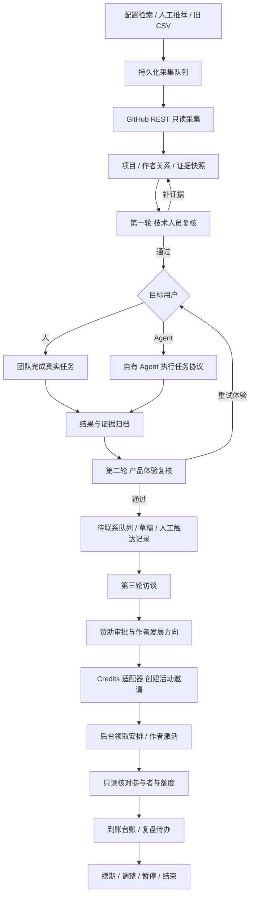

# 全球 AI 开发者赞助计划：自动化开发计划与完整技术路径

版本：2026-09-07 / v0.1 架构基线，已推进至 v0.2。适用范围：从 GitHub 发现潜在项目，到筛选、建联记录、访谈、Credits 赞助和复盘。

**v0.3 当前状态：** 浏览器全流程后台、会话与可选 OIDC、自动 Agent 消费和产物传输、schema v4、本机启动/停止及部署运维工具已交付。见 [v0.3 交付说明](../v0.3交付说明.md)。本文件保留历史架构与排期背景，当前实现和验收状态以最新交付说明与验证记录为准。

**v0.2 实施更新：** 本地原爬虫模块已进入正式调用链；团队 JSON API、Bearer 身份与角色权限、审批/执行隔离、Agent 租约与结果绑定、数据库 v3 迁移、tick/run/doctor 已完成。当前交付事实见 [v0.2 交付说明](../v0.2交付说明.md) 与 [实施任务清单](../实施任务清单.md)。下文关于“仅本地 CLI”“旧代码保留参考”以及将服务端权限列为后续工作的叙述是 v0.1 历史状态，以此更新为准。SSO、浏览器界面、长期部署和外部真实联调仍未完成。

## 1. 结论与交付边界

建议采用一个统一的筛选与赞助工作流，复用 GitHub 作为项目数据源、复用 OpenAI Next Credits 作为额度与领取系统，不另造一套账户和计费系统。

自动化目标是减少重复采集、整理、分发和核对工作，让每次决定都有证据。不能把“自动得到一个分数”当成完成代码复核，也不能把“README 描述了能力”当成真实体验。前两轮均通过才允许进入待联系队列；第三轮完成后才能审批赞助。

本次已经提供可运行的 Python CLI 实现、SQLite 数据结构、采集队列、审核门槛、Agent 任务协议、Credits 适配器、测试、示例及运行报告。它是本地可信操作模式下的实施基线，不是已经完成生产部署的多人平台。真实 Credits 端点、生产凭证、活动及自有 Agent 执行环境尚待接入。

## 2. 已核实的两个系统

### 2.1 GitHub 爬取程序

远端 `Next-AGI-Org/github-worker` 当前账号访问返回 404；不能确认私有、迁移或权限原因。本次基于用户工作区 `GitHub_Worker` 本地副本实现。没有推送或修改远端仓库。

旧程序提供按关键词/创建日期搜索、项目 CSV 和公开作者资料补全，但存在以下问题：

- `main.py` 指向不存在的 `src/python`，实际为 `src/py`。
- 引导函数调用与各模块实际函数不匹配，缺少 `logger`。
- 项目表到作者表缺乏显式构建过程，CSV/TSV 格式混用。
- `stars:>0` 漏掉零星项目；按创建时间搜索不能替代持续维护筛选；已有项目跳过导致信息不刷新。
- 包含“是否华人”推断和强制模型 Key 依赖，与全球计划不符。
- C++ 模块没有承载这里需要的筛选业务，也不必成为采集的启动依赖。

实施选择：保留旧源码供比对，将正式入口替换为 `worker/`，统一运行与存储。旧 CSV 只用来恢复仓库地址，重新获取事实；不迁移未经核实的旧画像。

### 2.2 Credits 系统

已通过 GitHub API 读取 `Kadxy/openai-next-credits`，核对版本：`057b78a1bca368dd9b77e56a3fb249f0918b1b98`。主要结构为 NestJS API、Next.js 管理/领取页面、Prisma 数据模型。源码中的真实接入能力如下：

| 事实 | 对方案的影响 |
| --- | --- |
| PAT 只允许标注 `@PatEnabled` 的 API；PAT 格式为 `onc_pat_…` | 使用专用 PAT，不复用 GitHub token，不模拟浏览器 Session |
| 邀请可以按活动创建、查询、更新或同步 | 赞助审批后创建一条活动邀请，采集候选不直接进入 Credits |
| `EventInvitation` 以 `(eventId,email)` 建立非空邮箱唯一约束 | 作者确认的邮箱是接收身份锚点；GitHub 账号名不能直接替代 Credits 账户 |
| 创建邀请不等于激活；激活后产生参与记录 | 分开记录 `awaiting_claim` 和 `issued` |
| `grantCents` 为邀请或参与者的额度总值 | 不把 PATCH 当成“增加 X cents”，不自动覆盖其他赞助额度 |
| PAT 可查询参与者及 `settledCents` | 可自动核对激活和已结算用量；不宣称它包含有效 Key 的全部实时消耗 |
| 邮件发送、claim-link、管理员 activate 未对 PAT 开放 | 使用现有 Credits 后台及作者自助领取，不绕过认证边界 |
| 到期时间由活动 `endAt` 控制，活动详情接口未对 PAT 开放 | 需管理员先建立活动并确认到期设置；审批日期必须匹配，不虚构单笔独立到期能力 |

源码依据与端点映射见 [Credits 接入说明](../Credits接入说明.md)。该仓库为当前账号可访问的私有仓库，外部读者需有权限。

## 3. 总体架构与责任边界

系统分工：

- Worker：发现、资料刷新、证据归档、待办、状态门槛、集成调用、核对和报告。
- 技术团队：第一轮签署；复核 Agent 日志；区分项目缺陷与测试环境失败。
- 人用产品体验团队：确定真实场景，完成任务，留下结果与比较。
- 自有 Agent：执行明确的体验任务，回传结果；不替团队自动批准联系或赞助。
- 运营/关系负责人：维护联系对象、实际触达、安排访谈与复盘。
- 计划负责人：决定支持目标、额度和续赞助；发展方向基于作者自述和访谈事实。
- Credits：账户、活动、邀请、激活、额度、Key 与已有计费/结算逻辑。

## 4. 完整业务路径：输入、自动动作与出口

| 路径 | 输入与触发 | 自动动作 | 人工判断 / 出口 |
| --- | --- | --- | --- |
| 新项目发现 | 分类查询、人工提交、历史仓库清单 | 搜索拆分、分页、稳定 ID 去重、记录来源、入队补全 | 进入待技术复核；发现数量不等于合格数量 |
| 已有项目刷新 | 调度运行、人工重新导入 | 更新资料和快照、发现 Commit 变化、保留旧证据 | 当前审核版本与新版本不一致时，阻断后续联系 |
| 第一轮证据整理 | 获取仓库及文件 | README、目录、少量代码、维护记录和问题样本 | 技术人员查核心实现、维护真实性、规范和重大缺陷 |
| 第一轮决策 | 复核表单 | 验证字段、Commit、责任人；保存历史 | pass / hold / reject；hold 可补证据后重新签署 |
| 体验任务创建 | 第一轮通过 | 绑定版本、目标用户、预设成功条件及预算 | 团队确认任务具有代表性 |
| 人用体验 | 人工执行任务 | 保存步骤、实际输出、截图/日志引用 | 使用价值、操作阻力、差异化及潜力 |
| Agent 体验 | 导出任务包或隔离执行镜像 | 资源限制、结果回传、不可覆盖的运行记录 | 技术人员判断任务是否真实完成，复核异常 |
| 第二轮决策 | 完整体验证据 | 校验所需用户类型均有成功任务；校验第一轮有效 | pass / hold / reject；通过后生成联系资格 |
| 建联管理 | 前两轮通过、维护者确认 | 去重、草稿、已联系/回复/拒绝记录 | 指定负责人实际发送；拒绝后禁止再次建立联系草稿 |
| 访谈 | 作者回复且愿意沟通 | 结构化纪要与待确认事项 | 三轮综合判断；画像可兼具或待定 |
| 赞助审批 | 访谈完成 | 校验金额、接收身份、有效期、复盘日期和已有赞助 | 批准 / 暂缓 / 不赞助；不自动承诺额度 |
| Credits 建邀请 | 已批准计划；显式执行 | 核对活动、账户及重复记录；创建邀请；记录关联 ID | 后台安排领取；创建只记 awaiting_claim |
| Credits 核对 | 等待领取、异常待核对、复盘前查询 | 只读查询邀请/参与者，验证激活、邮箱、额度及封禁状态 | 通过才记 issued；冲突/未知转人工核对 |
| 复盘 | 到账后约定日期 | 生成待办、读取已结算用量、保留里程碑证据 | continue / adjust / pause / end；续额度另作决策 |

## 5. 发现层：覆盖率与采集预算

### 5.1 搜索策略

按业务方向维护配置化查询：Agent Infra、AI Coding、RAG、路由/推理、应用。示例配置覆盖 topic 和名称/简介/README 关键词；团队根据命中样本持续补充术语、相关项目和非英语描述，不以地理位置过滤。

候选来源分三类：自动搜索、团队推荐、已知项目关联。当前实现前两类及历史 CSV 导入；贡献者关联扩展可在完成初批校准后引入，避免过度扩张人物图谱。

首次回溯建议覆盖最近 90 天推送的项目；日常运行回看最近 7 天，并刷新已有项目。重叠窗口用于抵消搜索索引延迟，不是保证没有遗漏。旧但仍维护的项目可被发现；零 Stars 可进入候选。

Stars、Forks、最近推送、Release、贡献人数是排序或证据线索，不作为统一淘汰阈值。机器人提交、自动依赖升级、镜像同步不能单独证明持续维护。成熟且稳定的软件提交少也可能值得保留。

### 5.2 GitHub 限制与失败处理

GitHub Search 每次搜索最多提供 1,000 个结果。因此按推送日期二分；单日仍超限时进一步按 Stars 数值范围拆分。若单日同 Stars 桶仍超限，则明确标记部分覆盖并保留可取得结果；不得把采完前 1,000 条称为全量。[GitHub Search 文档](https://github.com/github/docs/blob/main/content/rest/search/search.md)

使用 `Link` 分页信息判断后续页面；每页独立入队，避免中断后从整个检索重来。仓库稳定 ID 用于处理改名；项目可能同时命中多个方向，保留多条来源。[GitHub 分页文档](https://docs.github.com/en/rest/using-the-rest-api/using-pagination-in-the-rest-api)

运行时按响应头处理主限流和二级限流，保存任务下次可执行时间，暂停当前批次；对临时网络/服务器错误有界重试。权限和不存在错误进入可见失败队列，不转换成“无维护”。[GitHub 限流文档](https://docs.github.com/en/rest/using-the-rest-api/rate-limits-for-the-rest-api)

相同凭证范围下保存 ETag 与响应体，重复读取使用条件请求。缓存不跨不同 token 复用。所有调用只访问 GitHub API，令牌不写入业务日志。[GitHub REST 最佳实践](https://docs.github.com/en/rest/using-the-rest-api/best-practices-for-using-the-rest-api)

### 5.3 成本控制

本地刷新每项目通常约 8–12 次请求：元数据、当前提交、树、README、代码样本、维护/发布/Issue 和贡献者样本、所有者资料；具体数量取决于文件与接口可用性。默认串行，匿名或有凭证的基础间隔不同，同时服从服务端限流。

以 100 个新项目估算约 800–1,200 次详情请求，另加搜索请求；这只是工程预算，不是实际吞吐承诺。试运行先收少量项目，确定 API、技术复核与体验的真实成本再扩容。按已完成审核容量限制新候选量，避免只增加积压。

## 6. 证据层与评审标准

事实、分析和决策分别保存：采集快照记录 GitHub 返回的事实；自动摘要只能给证据索引及待查问题；人工评审记录结论、理由与签署人。

每个证据包包含仓库稳定 ID、采集时间、默认分支 SHA、来源 URL、部分失败清单、采样范围和截断说明。代码/README 尽量绑定 Commit；Release 和 Issue 等动态记录保留抓取时间。工程判断必须能够追溯到核心文件，自动抽取的三个代码样本只是入口。

第一轮不使用“分数够高自动通过”。最低证据包括：

1. 工程：实现与声称能力的对应、关键模块边界、错误处理及测试情况。
2. 维护：近期实质变更、问题响应或稳定维护证据；区分机器人、未知作者与已知人类账号。
3. 文档：用途、安装/运行路径、示例、License、依赖与已知限制。

第二轮先定义场景再执行：

| 方向 | 示例场景 | 应保留的比较和异常 |
| --- | --- | --- |
| Agent Infra | 自有 Agent 接入工具并完成多步任务 | 接入成本、协议错误、超时、恢复、可观测性 |
| AI Coding | 在授权的测试仓库修复具体问题并运行相关测试 | 相比现有流程的成功与失败、改动质量、人工接管 |
| RAG | 对给定语料回答可核验问题并给出支持证据 | 检索错误、无答案情形、引用可核验性、延迟 |
| 模型路由/推理 | 固定任务请求、模型不可用及限流情形 | 路由是否正确、错误语义、恢复、可取得的费用/延迟 |
| 应用产品 | 目标用户从首次进入到完成关键工作 | 是否真的节省工作、输出可用性、关键流失点 |

预算包含执行时长与可承担的模型费用，但费用字段本身不执行计费限制。联网任务必须由外部执行环境的账户预算/代理真实限制；本地 Docker 路径限制 CPU、内存、PID、时间并默认无网络。

## 7. Agent 自动化接口及隔离路径

`agent-export` 输出 JSON 任务包，包含 `schema_version`、项目、SHA、预定场景、成功条件、环境、输入、预算及证据快照。自有 Agent 回传 `{id, sha, result}`；`result` 包含真实执行步骤、输出、运行环境、执行主体、证据引用、成功标志和失败类型。

接入方式 A：自有 Agent 已有平台。由平台消费导出文件（以后可扩展消息队列/API），在已有隔离环境执行，回传结果文件，再由复核人签收。不能把本地导出成功视作 Agent 已完成任务。

接入方式 B：Docker 执行。运维提供预先审核并拉取的固定 digest 镜像，镜像内准备依赖及任务数据，读取 `/input/task.json`，写 `/output/result.json`。当前实现禁止自动拉取、默认断网、无宿主凭证、无 Docker socket、只读根目录、非 root，执行限时，超时清理容器。

联网产品需要另外配置独立执行主机、按任务限制的出口、测试账户及模型预算；不通过放开宿主机权限让通用脚本运行所有候选仓库。输出目录需配操作系统磁盘配额。当前环境未安装 Docker，尚无自有 Agent 实例或联网执行配置，因此只验证了任务协议和构造的隔离参数，未声称完成真实产品的 Agent 体验。

AI 辅助代码摘要可作为下一步增量：固定 JSON 输出，逐条要求源码/Commit 引用，把“不知道”作为合法结果，记录模型、提示词版本、成本和证据哈希；使用人工标注样本评估误判后再启用。当前没有接入 LLM 自动评分，更不会调用旧地域推断逻辑。

## 8. 数据结构、状态与一致性

本次使用 SQLite，面向单台机器、小规模团队通过可信操作员执行。实体已实现于 `worker/db.py`：

| 表 | 用途与约束 |
| --- | --- |
| projects / sources | 稳定仓库 ID、规范名、元数据、目标用户、当前阶段、负责人；发现来源可多条 |
| maintainers / project_maintainers | 作者资料、拒绝联系标志、多对多关系、角色确认及依据 |
| snapshots | 带 SHA/时间的证据快照及完整性 |
| reviews | 第一/二轮、版本、决定、理由、证据、签署人，追加保存历史 |
| experiences | 人/Agent 任务、预定条件、绑定版本、不可覆盖的结果 |
| contacts / interviews | 去重的联系记录、实际触达证据、访谈事实及作者自述发展方向 |
| decisions / grants | 审批与发放分离，一条批准关联一笔发放，额度/单位/接收方可核对 |
| followups | 复盘日期、证据、决定和下一步动作 |
| jobs / search_coverage | 入队去重、租约、尝试次数、延迟、错误、检索范围和覆盖缺口 |
| http_cache / events | 条件请求缓存、业务操作历史 |

状态是导航摘要，资格由服务方法重新校验，不能仅修改一列阶段就绕过审核。更新第一轮会使已有第二轮结果失效；当前 SHA 改变或评审超过默认 30 天也不能继续联系。后续生产版可配置不同证据有效期，当前通过 `Workflow(max_age_days=...)` 调整。

业务写入与事件日志在同一事务；队列有领取租约、失败退避和死信。采集任务按“至少一次执行”设计，通过稳定 ID 和去重键实现可重跑效果，不宣称跨外部系统 exactly-once。

Credits 网络调用前先持久化 `submitting`。请求失败、进程中断或响应无法识别时保留可核对状态，优先读取远端邀请。创建的邀请备注携带唯一 `sponsorship:<grant_id>`；相同邮箱但不同备注/额度时停止并提示冲突。该策略配合远端邮箱唯一约束避免重复创建，但不能防止其他后台管理员并发修改，冲突必须升级处理。

## 9. Credits 全路径与系统演进

首期使用专用赞助活动，审批金额显式采用 cents，收款邮箱必须由访谈对象确认。禁止推断或拼接邮箱替代确认。活动 slug、有效期和身份确认依据进入审批数据；适配器比较配置与审批。

执行顺序：离线预览 → 业务门槛检查 → 读取实时 OpenAPI 确认需要的 PAT 端点 → 查同邮箱邀请/参与记录 → 无冲突才创建 → 保存邀请 ID → 后台安排领取 → 轮询核对激活/邮箱/金额/封禁 → issued → 复盘。

以下能力与现有接口边界明确区分：

- 自动发邀请邮件：当前未实现，也未对 PAT 开放；沿用后台。以后若需要，先为发送动作提供独立授权、预览和幂等约束，不能简单给现有高权限方法加 PAT 注解。
- 自动管理员激活：当前不走此路径；优先作者自助完成身份与领取条件。
- 给已有参与者续赞助：当前阻止自动覆盖已有额度。短期可采用新一期专用活动并重新审批，或人工核对后台调整。若要自动追加，Credits 应新增赞助业务编号、追加金额、预期版本/余额与幂等流水的原子事务 API，再接入 Worker；现有 `PATCH grantCents` 不具备安全的增量重试语义。
- 单笔独立有效期：目前由活动日期控制；需要不同日期时分活动，或在 Credits 新增 grant 层有效期及下游 Key 同步规则，不能只在本地台账写一个日期。
- 实时总消耗：PAT 当前可取得已结算数据，实时有效 Key 消耗仍依赖现有 Credits 内部同步；复盘报告注明观察时间和口径。

## 10. 分阶段开发与上线计划

下面按依赖排期，是建议工作量而非已经发生的上线进度。默认 1 名后端/自动化工程师主责，技术复核和运营兼职参与；有前端需求再加入前端资源。

| 阶段 | 预计工作量 | 当前完成情况 | 交付与验收 |
| --- | --- | --- | --- |
| M0 代码审计与流程建模 | 1–2 工程日 | 本地代码与 Credits 契约已核对 | 范围、责任、状态、旧数据迁移原则明确 |
| M1 采集与证据 | 3–5 工程日 | 本地实现及公开仓库 smoke 已完成 | 发现/更新/拆分/限流/去重/错误可恢复；真实项目停在待复核 |
| M2 筛选与体验编排 | 3–5 工程日，另计真实体验 | CLI 门槛、记录和任务协议已完成；自有 Agent 待接入 | 人/Agent 两条路径各完成真实案例，证据可重放；未通过不能联系 |
| M3 建联/访谈/赞助台账 | 2–3 工程日 | 本地实现及合成流程已完成 | 同作者去重、拒绝联系生效、访谈后批准、发放与审批分离 |
| M4 Credits 端到端联调 | 2–4 工程日 | 源码适配及故障模拟已完成；生产参数待提供 | 测试活动创建邀请、作者测试账号领取、一次到账、超时核对、无重复 |
| M5 试运行与校准 | 约 1 周业务观察 | 待团队执行 | 约 20 个候选、至少 3 个方向，记录处理时间和误判；不设强行通过数量 |
| M6 多人生产服务（若需要） | 5–10 工程日以上 | 尚未实施 | SSO/RBAC、Web/API 审核入口、审批角色隔离、审计/备份/告警、部署验收 |

最短上线顺序是 M0–M4 的本地可信操作模式，再小批试运行。Web 后台不是验证赞助 SOP 的前置条件；若直接面向多人生产环境，则 M6 必须完成，不能将 `--actor` 文本标签当作身份验证。

## 11. 生产部署与运维路径

初期：专用机器上的 Python 3.11+、本机 SQLite、独立资料目录、配置文件和已有调度系统。代码、配置模板可放代码仓库，令牌与运行中数据库不进入仓库或 OneDrive 实时同步。

建议调度频率（尚未创建任何定时任务）：每天写入发现与刷新计划；每 5–15 分钟运行有界采集批次；审批后由操作员执行 Credits 预览/创建；等待领取期间由受控流程定期只读核对；每日生成待办报告。具体频率服从 API 和团队处理容量。

当前只提供一次性命令与跨平台脚本，未注册系统计划任务。生产调度应限制同一数据库的活跃 Worker 数量，优先串行执行；长时间执行任务不放进采集进程。

规模扩大后：把关系数据和任务租约迁移到 PostgreSQL，证据/日志迁移对象存储，Agent 执行放独立 Worker 集群。保持业务方法和 JSON 协议，避免重写筛选语义。没有实际规模瓶颈前不引入额外队列服务。

运维验收：

1. 凭证仅来自进程环境或密钥管理；GitHub 与 Credits 分开；不开启公开匿名写接口。
2. 用备份 API 创建一致性备份；恢复到新文件并核对记录数、事件历史和数据库完整性后切换路径。
3. 队列最老等待时间、死信、采集错误率、部分覆盖、待审核积压、未知发放结果和到期复盘可见。
4. 定时报告中的“无变化”不反复通知；只有阻塞、故障、需要动作或有意义结果才触发后续通知集成。
5. 规定维护者联系资料、体验日志和模型输入的保留周期；取决于业务需要和部署环境，当前未启用自动清理任务。
6. Credits API 升级后运行契约检查；实际管理员权限、活动约束及单笔额度限制由服务端最终执行。

## 12. 测试与验收矩阵

| 验收组 | 必测情形 | 当前证据 |
| --- | --- | --- |
| 采集 | 零星、仓库改名、多来源、索引不完整、超 1,000 拆分、限流/404、缓存 | 自动化测试；另有真实公开仓库读取 |
| 队列 | 重复 schedule、并发领取、租约过期、旧 Worker 不能确认新租约任务 | 自动化测试 |
| 审核 | 未过第一轮/第二轮不可联系、混合产品缺一条体验、失败体验、过期、版本变化、重新复核 | 自动化测试 |
| 关系 | 同作者多项目重复联系、作者拒绝后不再建立草稿 | 自动化测试 |
| Credits | 默认预览无网络、创建不记到账、响应丢失、未知不可重发、其他邀请不覆盖、金额/账户冲突、重复核对 | 模拟真实源码契约的测试；未对生产系统发放 |
| Agent | 镜像 digest、禁止宿主 shell 拼接、只读/断网/资源限制参数 | 构造命令测试；实际 Docker 执行待环境 |
| 备份 | 备份可读取且不覆盖现有文件 | 自动化测试，已修复 Windows 连接未关闭问题 |
| 完整流程 | 项目→两类体验→联系记录→访谈→批准→邀请→激活→复盘 | 明确标注的合成 demo，不能当作真实项目业务结果 |

上线前必须增加两组真实验收：团队和自有 Agent 各体验至少一个合格候选；在 Credits 测试活动内完成真实测试账户的邀请、领取、额度与到期核对。没有这两组结果时，只能声称本地流程和适配器完成，不能声称整个赞助计划已自动运营。

## 13. 团队需要提供的接入材料

- Credits：部署 API 基址、专用活动 slug、管理员确认的活动 `endAt` 与其他领取要求，以及在本机配置的 `NEXT_CREDITS_PAT`。不要把密钥写到文档或对话。
- 自有 Agent：已有调用方式或审核过的镜像、可用测试环境、测试账户、模型预算及网络出口策略。
- 业务：第一轮签署人、人用体验负责人、Agent 结果复核人、关系负责人、批准及发放责任人。
- 试运行：首批候选容量、每个体验任务的时间/费用预算、初期赞助额度政策和复盘节奏。

这些材料影响真实系统联调和运营，不影响本次已完成的代码、计划、协议及本地验证。
