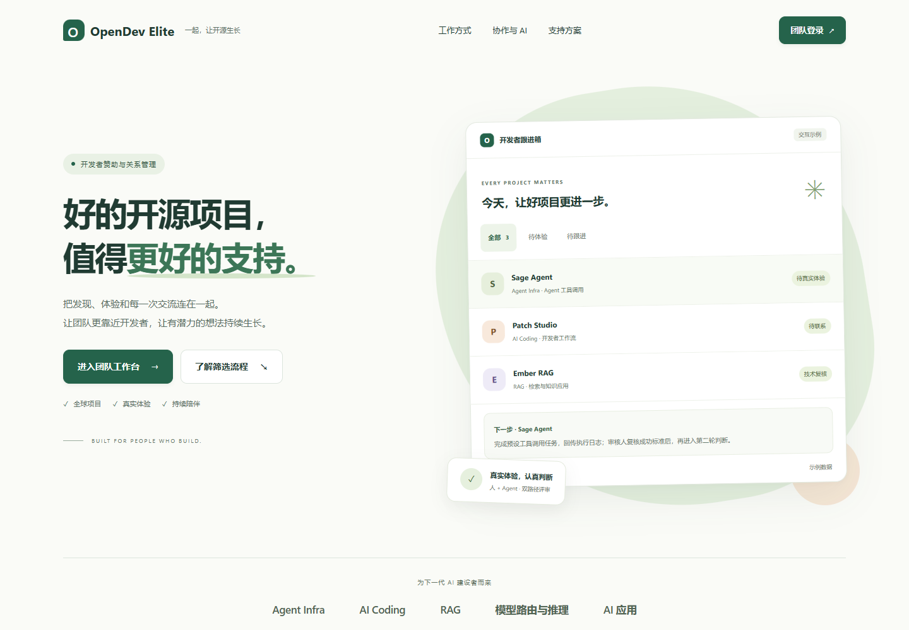
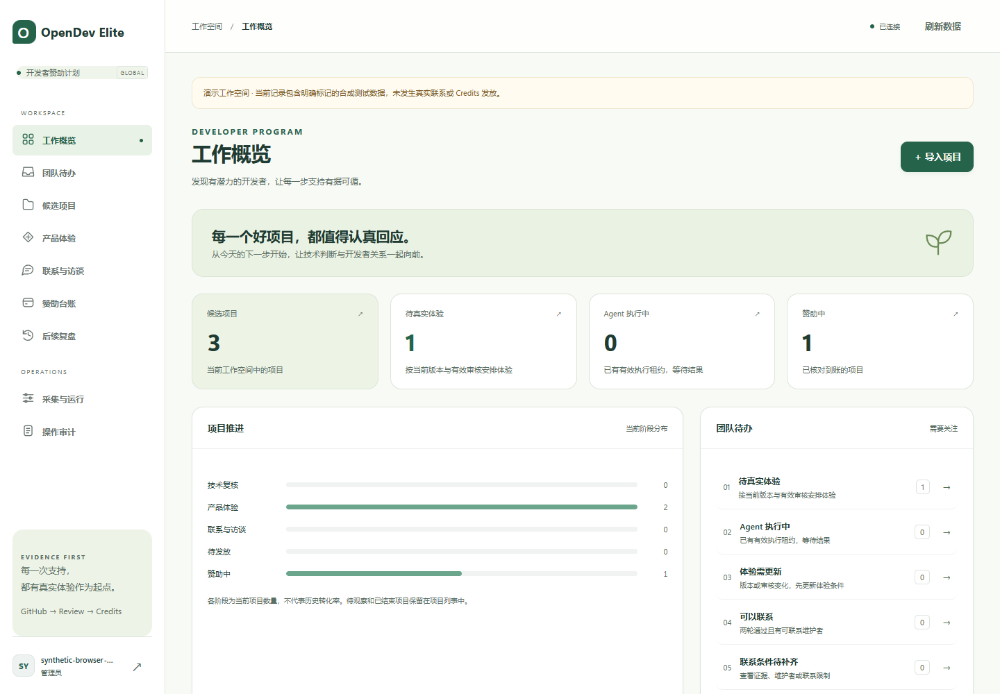
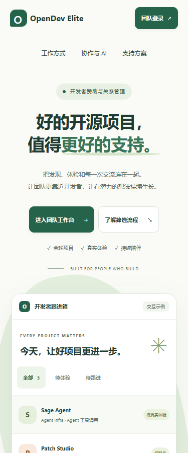

# OpenDev Elite v0.4.1 交付说明

本版完成 OpenDev Elite 命名和 Docker Compose 部署实现。业务 SOP、GitHub 原爬虫调用链、独立审核 / 审批 / 发放权限继续沿用，数据库 schema 保持 4。

## 交付内容

- `Dockerfile`：Python 多阶段构建、OIDC 依赖、UID 10001、安装包隔离启动。
- `compose.yaml`：无网络初始化、API、采集 Worker、共享回环网络的 Nginx 网关和手动维护服务；本地数据卷、健康检查、退出顺序、日志轮转。
- `worker/container.py`：幂等初始化、origin 一致性检查、原子配置导入、Secret 文件读取、健康和在线备份入口。
- `.dockerignore`：构建上下文白名单，排除本地配置、凭证、数据库和产物。
- `.env.example`、[部署手册](DockerCompose部署.md)、Compose 冒烟脚本与 Ubuntu CI 任务。
- 首页、流程助手、侧栏、页脚、页面标题和 OpenAPI 名称统一为 OpenDev Elite，镜像与 Compose 项目名为 `opendev-elite`。Python 包名称和既有本机数据目录保持兼容。

## 验证依据

253 项 Python 回归通过；Compose 官方 Schema 与结构校验通过；实际浏览器 27 项既有基础检查和 17 项新品牌 / 响应式检查通过。证据位于 `docs/verification/v041-*` 和交付目录的 `artifacts/validation/`。

**容器实机验收尚未执行**：开发机没有可用 Docker Engine，注册的 WSL Ubuntu 磁盘缺失。CI 已配置构建、启动、登录、来源拒绝、备份及重建后持久化检查，需在可用 Docker 主机执行后才能标记容器验收完成。当前本机运行方式继续为 Windows Python 服务，不能写成已经切换到 Docker。

## 界面预览

