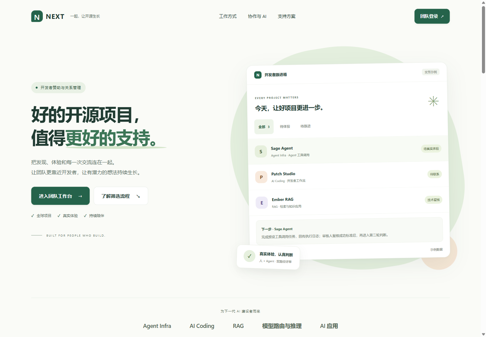
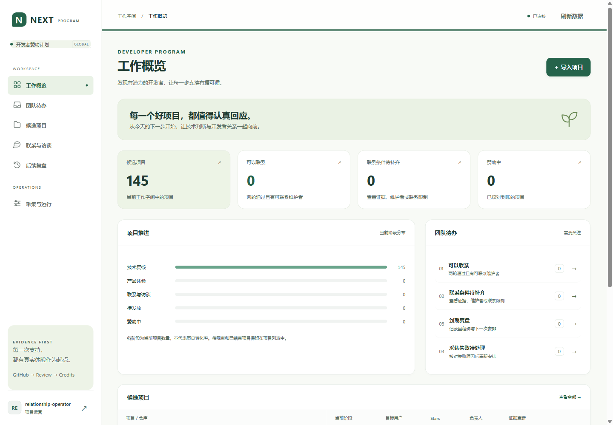

# v0.4 交付：更清楚的规格、更准确的流程、更友好的界面

2026-09-07。本轮已完成开发文档、SOP 业务迭代和前端 UI 优化，并在本机正式工作空间运行。入口：http://127.0.0.1:8765。

## 本轮完成内容

1. **开发文档**：重写当前开发规格，将 v0.1–v0.3 历史规划归档；明确三轮筛选、责任边界、代码地图、验收矩阵及发布顺序。
2. **业务流程**：修复新赞助周期的阶段显示、过期后实际入站回复记录、联系资格与体验队列漂移；统一证据门槛；复盘继续、调整、暂停都有下一次结构化安排。
3. **可操作待办**：按角色区分待体验、执行中、需更新、可联系、联系条件待补齐、到期复盘及采集失败。点击定位到具体项目或记录。
4. **完整 CRM 首页**：使用用户指定 ui-ux-pro-max 技能，采用暖白、松绿、鼠尾草绿和杏色；包括跟进工单预览、完整 SOP、多渠道协作、Agent 集成、流程对话示例、支持方案对比、FAQ 和团队登录。
5. **工作台体验**：统一概览、导航、列表、详情、表单、状态和手机布局；完善表单联动、错误说明、画像选择、键盘焦点和退出保护。
6. **交付与运行**：v0.4 安装包和源码包，独立安装验证，Windows 隔离导入、独占端口、本机升级、健康检查及快照备份。

## 需求逐项验收

| 要求 | 结论 | 实际依据 |
| --- | --- | --- |
| 先优化开发文档 | 完成 | 当前开发规格、历史归档、操作/API/部署指南，文档链接检查 |
| 逻辑迭代符合完整 SOP | 完成 | 14 项 v0.4 工作流回归及已有门槛/采集/额度测试；见逻辑变更说明 |
| 工单管理预览 | 完成 | 首页筛选与详情交互，明确示例数据；真实待办单独认证读取 |
| 多渠道功能 | 完成 | GitHub 自动资料采集；Email/社区/访谈事实记录说明；不虚称外部同步或自动发送 |
| AI 聊天与 Agent 集成展示 | 完成 | 可输入问题的本地 SOP 对话预览，明确非实时模型；Agent 任务/产物协议仍连接真实业务层 |
| 定价/方案比较 | 完成 | 三类支持方式、成本决定方式、条件和选择反馈；未提供统一价格，明确按访谈/审批，不编造金额 |
| 深度前端 UI 优化 | 完成 | 新首页、概览、项目与记录、表单、空态/错误态；截图与实际浏览器操作 |
| 响应式和基础无障碍 | 完成 | 375/768/1024/1440 宽度；无整页横向溢出；可见文字对比、主要按钮尺寸、跳转焦点及减少动态检查 |
| 安全和业务不回退 | 完成 | 244 项测试；真实表单保存与身份/对话框/提交延迟竞态验证 |
| 安装及本机运行 | 完成 | wheel 离开源码目录以 Python -I 验证 9 个 HTTP 路径；正式工作台 v0.4.0、数据库/API 健康正常 |

## 验证证据

- **244 项 Python 测试通过，无跳过**，Windows / Python 3.13.13，48.266 秒。[完整测试记录](verification/v04-unit-tests.txt)。新增 14 项业务边界和 10 项待办/HTTP/端口验证。
- 实际 Chromium 浏览器：27 项基础交互断言、13 项表单及退出竞态、4 项晚返回提交保护检查通过。[结构化浏览器记录](verification/v04-browser-checks.json)。测试账号、业务写入与 Credits 响应均为独立合成样本。
- 可见首页和概览文字经过计算式对比检查；主要按钮高度不小于 44px，键盘跳转到主内容、prefers-reduced-motion 生效。该检查不等同于全站 WCAG 认证。
- JavaScript 语法、Python 编译、PowerShell AST、文档链接与安装包源文件一致性检查通过。
- 正式库只读浏览器快照：145 个候选，其中 137 个待补全、8 个技术复核阶段。候选数会随采集变化；没有据此认定任何项目已通过筛选、已联系或已赞助。
- 正式工作空间使用新 v0.4 专用运行环境；旧 v0.3 环境和先前备份保留。本轮无 schema 升级；v0.4 上线后的检查点备份已完成且 integrity_check=ok。

## 交付文件与后续运行

安装包：`artifacts/dist/github_sponsorship_worker-0.4.0-py3-none-any.whl`。

源码包：`artifacts/dist/github-sponsorship-v0.4.0-source.zip`。

哈希与测试摘要：`artifacts/dist/release-manifest.json`。源码包包含设计系统、源码、测试、截图和文档，不含实际凭证、DB 或私有运行配置。

登录使用初始化生成的个人角色凭证；真实操作继续受服务端角色和门槛限制。业务解释见 [团队操作指南](团队操作指南.md)，升级/恢复见 [部署手册](部署手册.md)，具体改动见 [v0.4 逻辑变更](v0.4逻辑变更.md)。

## 外部验收边界

真实企业 IdP、Credits 活动/PAT、Docker/指定 Agent 镜像、云端主机仍未配置，本轮没有代替团队真实体验产品、联系作者或发放 Credits。首页方案选择不提交申请，本地对话示例不调用外部模型。部署模板不等于云端已上线。GitHub 匿名采集仍受配额限制，当前进程按退避策略执行。
