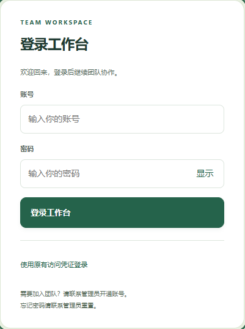
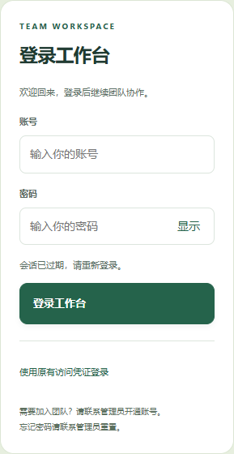
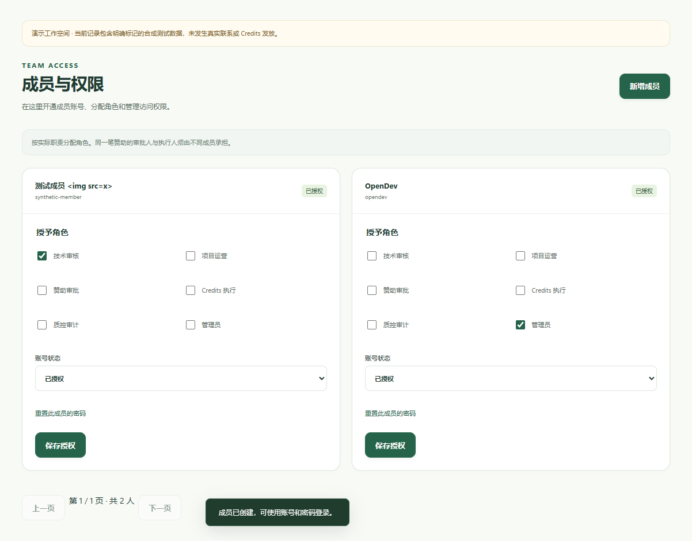

# OpenDev Elite v0.5.1

默认管理员为 **OpenDev / 123456**，首次运行自动初始化。公开创建管理员和注册成员页面及接口已关闭；管理员通过“成员与权限 → 新增成员”填写账号资料并分配角色，创建后成员即可登录。

登录页提供密码显示切换、提交状态、错误提示和大写锁定提示。新增成员提供密码确认、角色校验、取消清空密码以及移动端布局。原有修改密码、角色授权、停用、旧会话失效、最后一位管理员保护及 Token/SSO 兼容继续保留。

默认账号仅初始化一次；修改后的密码不会被重启或容器重建覆盖。已有 v0.5 账号保留，不额外添加默认管理员。新成员和修改后的密码至少 6 个字符，初始管理员密码为 123456。

## 验证

- 全量 Python 回归 **274 项通过**，其中账号测试 **21 项**；日志见 [v051-unit-tests.txt](verification/v051-unit-tests.txt)。
- Playwright 实际浏览器 **24 项检查通过**，覆盖默认管理员登录、公开注册入口移除、密码切换与失败反馈、成员创建/角色/改密/停用、无密码本地存储，以及 375/768/1024/1440 宽度布局；无未捕获 JavaScript 错误。登录未认证、错误密码和撤销会话会产生预期 401 HTTP 响应。
- 独立安装 wheel，以 `python -I` 验证包内资源、版本、接口和待办读取。
- 本机服务已备份并升级至 v0.5.1，默认账号登录与退出验证见 [v051-production.json](verification/v051-production.json)。测试成员只存在于独立合成演示库。
- Compose 默认镜像版本已更新，启动命令仍为 `docker compose up -d`。CI 冒烟脚本已同步默认登录、后台新增成员及改密后重建持久化检查；本机没有可用 Docker Engine，本轮未执行容器运行验收。

## 页面

使用和升级步骤见 [账号登录与成员管理](账号注册与授权.md) 与 [Docker Compose 部署](DockerCompose部署.md)。数据库版本保持 schema 5。
