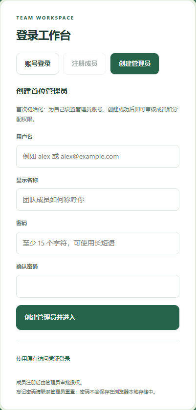
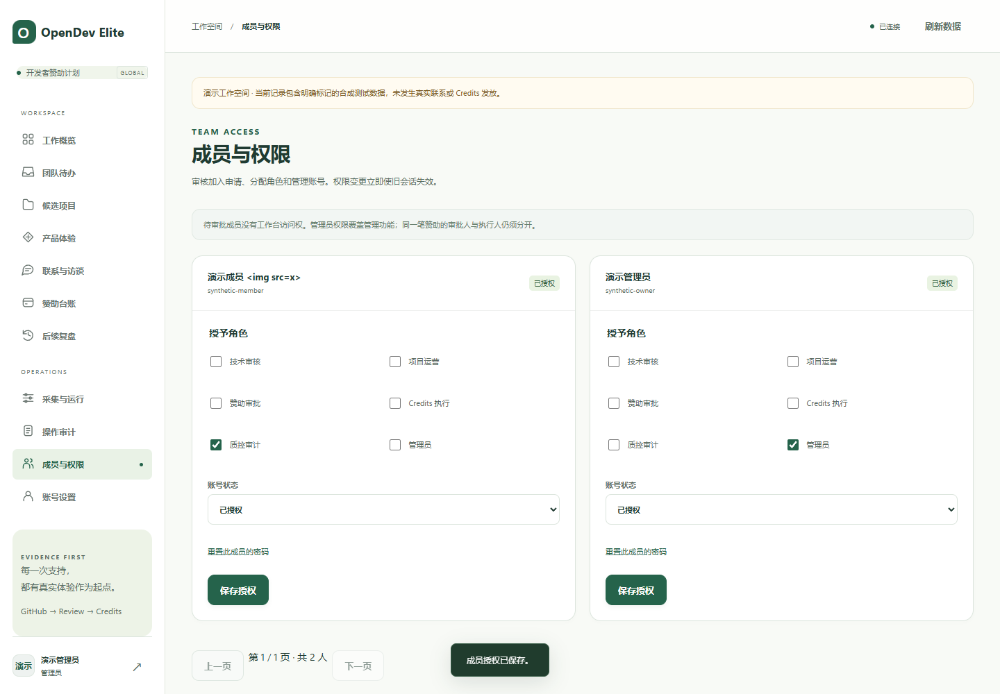
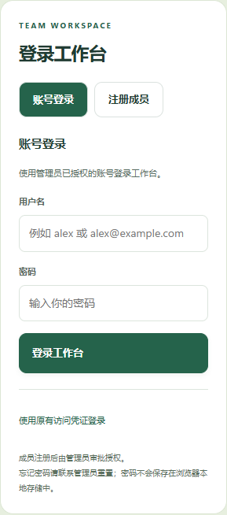

# OpenDev Elite v0.5.0 · 注册、登录与授权

本版把人工登录默认入口改为用户名和密码：部署者在页面创建首位管理员，其他成员注册后由管理员审批授权。用户无需从服务器领取 Token。原 Token / Agent / SSO 保持兼容，业务数据和 Credits 仍按角色访问。

## 已实现

- 一次性、本机 origin 的首位管理员注册；状态保存在数据库，首次创建并发只有一个成功。
- 成员自主申请、待审批阻止登录、管理员授权或拒绝、调整角色和停用。
- 本人改密、管理员重置成员密码、部署者通过交互式 CLI 恢复密码。
- 密码慢哈希与随机盐、登录限流、计算并发限制、精确 Origin / CSRF、版本化会话撤销、最后一位管理员保护。
- 角色与密码变更记录审计，不记录明文密码或返回密码摘要；密码重置的幂等指纹也使用慢派生，避免产生快速验证密码的旁路。
- 注册、登录、成员管理和账号设置界面；旧 Token 登录收起为兼容入口。
- SQLite schema 4→5 增量迁移、原库在线备份、Docker Compose 默认命令与镜像版本更新。

## 验证与交付边界

269 项 Python 测试全部通过；25 项实际浏览器账号流程检查通过，四种视口尺寸无整页横向溢出。安装 wheel 的资源和 API 已通过隔离环境验证。源码、测试、部署说明和证据一并打包。

本机服务使用 Windows Python 运行方式升级，生产管理员留给用户自行注册。测试中创建的账户全部属于有明确标记的演示数据库。Docker 配置和验收脚本已更新，但开发机没有可用 Docker 引擎，因此不宣称本轮做过容器启动验收。

旧程序不能直接打开 schema 5。升级前需保留数据库和配置备份，并停止旧 API / Worker；回退须使用兼容版本的升级前数据库。具体操作见 [账号注册与授权](账号注册与授权.md)和 [Docker Compose 部署](DockerCompose部署.md)。

## 页面验证截图

